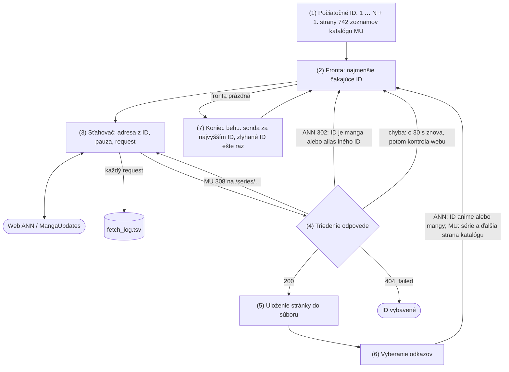

# 2. konzultácia – crawler (K2a)

Projekt: vyhľadávač anime a mangy. Anime aj mangu sťahujem z encyklopédie Anime News Network (ANN), mangu aj z MangaUpdates (MU).
Crawler je hotový a oba weby sú stiahnuté celé: ANN 40 293 stránok (4,8 GB), MangaUpdates 231 915 stránok (30,9 GB),
spolu 272 208 stránok a 35,7 GB HTML (výsledok na konci stránky).

## Frameworky a knižnice

| Čo | Prečo |
| --- | --- |
| Python 3.14 | odporúčaný jazyk predmetu |
| `requests` (Session) | jedno spojenie a gzip pre všetky requesty; presmerovania riešim sám (`allow_redirects=False`), aby som každý krok zalogoval a nasledoval iba adresy, ktoré sťahujem |
| `re` | odkazy aj polia diel vyberám regexom, nie podľa štruktúry stránky (XPath a BeautifulSoup sú zakázané) |
| štandardná knižnica (`heapq`, `signal`, `hashlib`, `logging`) | fronta, bezpečné zastavenie, kontrolný súčet stránky, logy |
| vlastná kontrola robots.txt | Python má na robots.txt modul `urllib.robotparser`, ale ten nepozná hviezdičku (`*` = hocijaké znaky). ANN zakazuje `Disallow: /encyclopedia/*&lookup=`, teda všetky stránky encyklopédie s `&lookup=` v adrese. `robotparser` berie `*` ako obyčajný znak, takže by zakázanú stránku `anime.php?id=13&lookup=error` povolil. Moja kontrola hviezdičku pozná (podľa štandardu RFC 9309). |
| uv, ruff, ty, pytest | projekt, formátovanie a kontrola kódu, testy |

Stránky sú obyčajné HTML (dáta sú priamo v ňom, nie načítané JavaScriptom), takže stačí `requests` a netreba Selenium ani Playwright.
Stránky ukladám ako súbory HTML a metadáta do TSV.

## Prečo crawler ide po ID

Bežný crawler začne na pár stránkach a ide po odkazoch. Tu by to nefungovalo:

- **Diela na seba odkazujú málo.** Cowboy Bebop má 977 odkazov na ľudí, ale iba 2 na iné anime. Po odkazoch by sa veľa diel nenašlo.
- **Zoznamy diel nesmiem použiť (ANN).** robots.txt ANN zakazuje zoznamy (`/encyclopedia/reports`, `/encyclopedia/anime-`),
  vyhľadávanie (`/encyclopedia/search/`) aj API (`api.xml`). Sitemap ANN nemá (`sitemap.xml` vracia 404).
- **Diela majú číselné ID.** `anime.php?id=13` je Cowboy Bebop. Anime aj manga majú spoločné číslovanie 1 až ~41 000,
  s malými dierami (najdlhšia 20 ID za sebou).

Crawler preto prejde všetky ID od 1 vyššie a odkazy iba dopĺňa. Na MangaUpdates je to rovnaké pre staré série
(`series.html?id=1` až ~205 000). Nové série (asi od 2022) staré ID nemajú, tie berie zo zoznamu sérií (katalóg nižšie),
ktorý robots.txt MU povoľuje.

## Architektúra

Kroky pre jedno ID (v zátvorke anglický názov, ktorý sa bežne používa):

1. **Počiatočné ID (seed):** všetky čísla diel, nie pár úvodných stránok. ANN 1–41 000, MangaUpdates 1–205 000 a prvé
   strany 742 zoznamov katalógu.
2. **Fronta (frontier):** ID, ktoré treba ešte stiahnuť. V pamäti halda (vždy najmenšie čakajúce ID), na disku `frontier.tsv`.
   Pribúdajú do nej ID z odkazov (krok 6), z presmerovaní ANN a chýb (krok 4) a z konca behu (krok 7).
3. **Sťahovač (fetcher):** z ID zostaví adresu (ANN `anime.php?id=N` alebo `manga.php?id=N`, MU `series.html?id=N`,
   strana katalógu alebo `/series/<nové ID>/<názov>`), počká na koniec pauzy, pošle request a zapíše ho do
   `fetch_log.tsv`. Adresy sú iba z týchto vzorov a robots.txt pri štarte overí jednu adresu každého z nich.
4. **Triedenie odpovede (classifier):** podľa HTTP kódu rozhodne, čo ďalej (tabuľka nižšie). Je to jediná časť, ktorá sa
   pre ANN a MangaUpdates líši (`sites/ann.py`, `sites/mangaupdates.py`). MU 308 sťahovač nasleduje hneď, ANN 302
   vráti ID do fronty, 404 a `failed` ID uzavrú („ID vybavené“ v diagrame).
5. **Uloženie stránky:** jeden súbor HTML, `raw/<druh>/<ID/1000>/<ID>.html`. Stránka sa najprv zapíše do dočasného súboru
   a až celá sa premenuje na `<ID>.html`. Ak crawler spadne uprostred zápisu, ostane iba dočasný súbor a stránka sa stiahne
   znova; nikdy nevznikne useknutý `<ID>.html`, ktorý by vyzeral ako hotový. Uložené stránky sa už nemenia.
6. **Vyberanie odkazov (link extractor):** regex nájde odkazy na diela, ľudí a firmy a zapíše ich do `links.tsv`.
   Na ANN odkaz `manga.php?id=N` prezradí, že ID N je manga, takže sa rovno stiahne `manga.php` bez presmerovania
   (Anime alebo manga nižšie). Na strane katalógu MU sú odkazy na série: série, ktoré ešte nemám, idú do fronty.
   Odkazy vyberá crawler, lebo podľa nich rozhoduje, čo stiahnuť ďalej; polia diel vyberá až parser (K2b).
7. **Koniec behu:** keď je fronta prázdna, crawler skúša ID za najvyšším nájdeným (nové diela) a potom ešte raz
   zlyhané ID (poradie nižšie). Až potom beh skončí.

| Odpoveď | Výsledok v logu | Čo ďalej |
| --- | --- | --- |
| 200 | `saved` | uloží stránku (krok 5) a vyberie odkazy (krok 6) |
| ANN: 302 na `manga.php` toho istého ID | `manga` | ID je manga: po pauze stiahne `manga.php?id=N` |
| MU: 308 na `/series/<id>/<názov>` | `redirect` | po pauze stiahne cieľ (2 requesty na sériu) |
| ANN: 302 na iné ID | `alias` | cieľ ide do fronty |
| 404, MU: 307 na `/series` | `missing` | nič, ID neexistuje |
| 500 / 502 / 504, timeout | `retry` | o 30 s znova; pri druhej chybe kontrola webu (nižšie) |
| 403 / 429 / 503, Cloudflare výzva | `blocked`, `challenge` | rovnako ako chyba; nič neobchádzam, iba čakám (aj `Retry-After`) |
| žiadna odpoveď (výpadok mojej siete) | `offline` | znova o 30 s, bez limitu |

**Chyba stránky alebo webu:** pri druhej chybe toho istého ID crawler skontroluje web: stiahne znova poslednú uloženú
stránku. Ak web odpovedá, chyba je iba tejto stránky: ID dostane `failed` a crawl ide hneď ďalej. Ak web neodpovedá,
je dole: celý crawler čaká 5 min a skúša to isté ID, kým web nenabehne. Jedna zlá stránka tak crawl nezdrží a pri výpadku
webu crawler server nezaťažuje ďalšími requestmi.

**Anime alebo manga (ANN):** z čísla ID nevidno, či je to anime alebo manga. Crawler preto najprv skúsi `anime.php?id=N`
a ak je to manga, ANN ho presmeruje na `manga.php?id=N` (jeden request navyše). Ak ID pozná z odkazu na inej stránke
(napr. „adapted from“ na stránke anime ukazuje na `manga.php?id=N`), ide rovno na mangu. Na to si v pamäti drží slovník
*ID → manga* (~2 MB), ktorý pri štarte naplní z `links.tsv` a `fetch_log.tsv`. Takto sa ušetrilo ~15 000 requestov
(~20 h crawlu): z 26 467 máng išlo cez presmerovanie iba 11 620.

**Presmerovanie na MangaUpdates (2 requesty na sériu):** MU má pre série nové ID (`tvb7av1`), ktoré sú náhodné a nedajú
sa vypočítať. Crawler preto ide po starých číselných adresách `series.html?id=N` a MU každú presmeruje (308) na
`/series/<nové ID>/<názov>`. Každá séria tak stojí 2 requesty. Presmerovanie crawler nesleduje automaticky: zapíše ho
do `fetch_log.tsv` a stiahne ho, iba ak je to adresa série (`/series/<nové ID>/<názov>`), teda vzor, ktorý robots.txt
povoľuje. Neexistujúce ID stojí 1 request (307 na `/series`).

**Katalóg MangaUpdates (nové série):** zoznam sérií `/series?year=Y&licensed=yes|no&type=T[&genre=G]&perpage=100&page=P`
(robots.txt tieto parametre povoľuje). Web ukáže najviac 30 strán (3 000 sérií) na zoznam, ďalšie strany odmietne (HTTP 429).
Zoznamy sú preto rozdelené vopred tak, aby každý mal menej ako 3 000 sérií: rok 2020–2026 × licensed áno/nie × typ
(17 typov), mangu ešte podľa žánru (36 žánrov), spolu 742 zoznamov. Crawler nikdy nežiada stranu za 30. Séria zo zoznamu,
ktorú ešte nemám, stojí 1 request (adresa je v zozname). Doujinshi (amatérske diela fanúšikov) nesťahujem, do indexu nepatria.

**Poradie v jednom behu:** najprv všetky čakajúce ID, potom sonda za najvyšším nájdeným ID (nové diela, kým nepríde 1 000
chýbajúcich za sebou), nakoniec druhý pokus o zlyhané ID. ID skontrolované za poslednú hodinu sa neskúšajú.

**Zastavenie a reštart:** crawler sa dá kedykoľvek zastaviť. Pri štarte prečíta `frontier.tsv`, `fetch_log.tsv`
a `links.tsv` a pokračuje tam, kde skončil.

**Oproti návrhu z hellointerview:** fronta = halda v pamäti + `frontier.tsv`, úložisko stránok = súbory `raw/`, databáza
metadát = TSV súbory (časť Metadáta), parsovanie entít je samostatný krok nad uloženými stránkami. Jeden proces na web
a v ňom jeden request naraz, lebo pri jednej doméne by paralelné sťahovanie porušilo pauzy.

## HTTP hlavičky

| Hlavička | Hodnota | Prečo |
| --- | --- | --- |
| User-Agent | `VI2026-student-crawler/0.1 (FIIT STU course project; xbabiar@stuba.sk; +https://vi2026.ui.sav.sk)` | poctivý: kto som a ako ma kontaktovať, nepredstieram prehliadač |
| Accept | `text/html,application/xhtml+xml;q=0.9,*/*;q=0.8` | chcem iba HTML |
| Accept-Language | `en` | anglický text |
| Accept-Encoding | `gzip, deflate` | ~5× menší prenos (Cowboy Bebop 96 kB namiesto 545 kB) |

Cookie zo session si nechám (inak ANN zakladá novú session pri každom requeste), iné cookies neposielam.

## Timeout a pauzy

| Nastavenie | Hodnota | Prečo |
| --- | --- | --- |
| Timeout pripojenia / čítania | 10 s / 30 s | pripojenie: ako dlho čakám, kým server prijme spojenie; čítanie: ako dlho čakám na ďalšie dáta odpovede. Bežná stránka príde celá za 0,4–1,5 s, takže dlhšie čakanie znamená problém servera; request sa potom zruší a berie sa ako chyba (`retry`) |
| Pauza medzi requestmi ANN | 2 s + náhodne 0–2 s | robots.txt ANN má `Crawl-delay: 2`, nikdy nejdem rýchlejšie |
| Pauza medzi requestmi MU | 1 s + náhodne 0–0,2 s | robots.txt nemá Crawl-delay; v logoch sledujem 403/429/503 |
| Prestávky | 30 s každých 5 min, 60 s každú hodinu | menej súvislej záťaže |
| Chyba alebo odmietnutie | o 30 s znova (alebo dlhší `Retry-After`), potom kontrola webu; web dole → 5 min | jedna zlá stránka nezastaví crawl, výpadok webu sa prečká |
| Výpadok mojej siete | skúsiť znova o 30 s, nepočíta sa do pokusov | Wi-Fi |
| robots.txt | pri štarte, kópia na disk; ak nepovoľuje všetky adresy, ktoré sťahujem, crawler sa hneď zastaví | zmena pravidiel sa prejaví pri ďalšom štarte |

Pauza sa počíta od prijatia odpovede, nie od odoslania requestu. Namerané: ANN ~970 requestov/h,
MU ~1 300–1 600 requestov/h.

## Metadáta, ktoré ukladám

| Súbor | Stĺpce | Na čo |
| --- | --- | --- |
| `fetch_log.tsv` | čas, beh, URL, ID, pokus, HTTP kód, výsledok, presmerovanie, bajty, SHA-256, čas odpovede, čas renderovania servera, cesta k súboru, chyba | 1 riadok = 1 request; obnovenie crawlu a štatistiky |
| `responses.tsv` | čas, beh, ID, URL, kód, všetky hlavičky odpovede (bez Set-Cookie) | kontrola cache a ochrany proti botom |
| `pages.tsv` | čas, ID, druh, titulok, bajty, počty odkazov podľa druhu, cesta | prehľad stiahnutých stránok |
| `links.tsv` | z ID, druh cieľa, ID cieľa, text odkazu | odkazy na diela, ľudí a firmy (ANN 3,07 M riadkov, MU 3,20 M) |
| `frontier.tsv` | čas, URL, ID, zdroj (seed, stránka s odkazom, alias, druhý pokus, sonda) | čo a odkiaľ sa dostalo do fronty |
| `catalog_by_type.tsv` (MU) | čas, rok, licensed, typ, žáner, strana, počet sérií, posledná strana, cesta | priebeh katalógu |
| `runs.tsv` | štart a koniec behu, PID, nastavenia, dôvod konca, súhrn | štatistiky behov |

TSV, nie CSV: názvy firiem a mien obsahujú čiarky („Co., Ltd.“). Stránky ani dáta nedávam na GitHub ani na wiki (autorské práva).

## Výsledok crawlu

Oba crawly skončili samy, nič nečaká.

| | ANN | MangaUpdates |
| --- | --- | --- |
| Requesty | 89 663 | 498 562 |
| Uložené stránky | 40 293 (13 826 anime + 26 467 manga) | 231 915 (178 688 starých ID + 50 693 nových sérií + 2 534 strán katalógu) |
| Neexistujúce ID | 1 316 | 26 307 (zmazané alebo zlúčené série) |
| Aliasy (iné ID toho istého diela) | 88 | – |
| Zlyhané | 0 | 13 (HTTP 429 aj pri druhom pokuse) |
| HTML na disku | 4,76 GB | 30,9 GB |
| Odkazy (`links.tsv`) | 3,07 M | 3,20 M |
| Chyby servera | 5× 502, 6× timeout | 336× 503, 227× 429, 14× 500/502/504, 15× timeout |

Spolu 272 208 stránok a 35,7 GB HTML. Blokovanie (403, Cloudflare výzva) ani raz. Výpadky mojej Wi-Fi
(ANN 2 367, MU 4 144 requestov bez odpovede) crawler prečkal sám.
