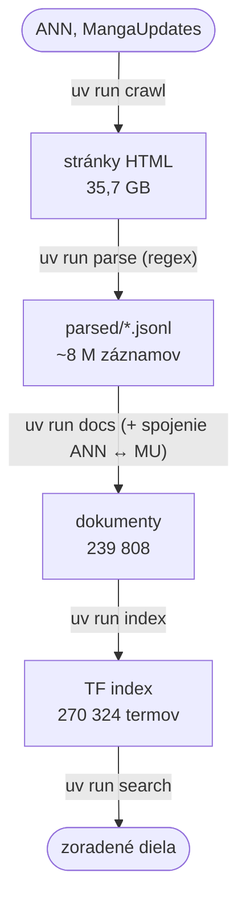
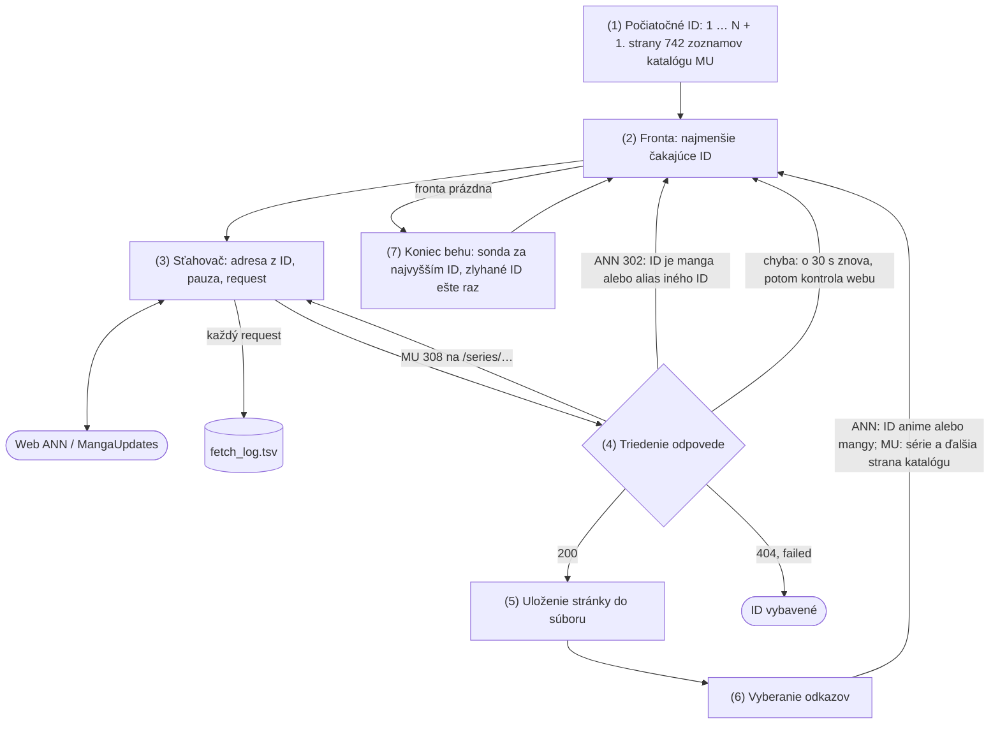

# 1. odovzdanie – crawler, extrakcia, vlastný index

## 1. Popis projektu a cieľ

Vyhľadávač anime a mangy. Nájde dielo podľa názvu (aj alternatívneho), deja, žánru, roku, autora, štúdia alebo režiséra
a pri každom diele ukáže súvisiace diela z druhého webu: k mange jej anime, k anime predlohu na MangaUpdates (časopis,
vydavateľ, kapitola, kde anime končí).

Prečo to nestačí na samotných weboch: na Anime News Network (ANN) aj MangaUpdates (MU) je každé dielo samostatná stránka,
vyhľadávanie ANN hľadá hlavne v názvoch a anime a manga sú na rôznych weboch. Google vráti jednotlivé stránky, na otázku
cez viac diel a oba weby priamo neodpovie.

**Dokument** = jedno dielo (anime alebo manga): jeden JSON objekt, ktorý index číta a vyhľadávanie vracia. Diela z ANN
a MU, ktoré sú to isté dielo, na seba odkazujú (nezlučujú sa).

Každý krok číta výstup predošlého a dá sa spustiť znova bez ostatných:



## 2. Stiahnuté weby a extrahované dáta

| Web | Čo z neho beriem | Stiahnuté stránky |
| --- | --- | --- |
| [Anime News Network](https://www.animenewsnetwork.com/encyclopedia/), encyklopédia | anime a manga: názvy, typ, rok, žánre, témy, dej, štáb a štúdiá (s ID osôb a firiem), vzťahy medzi dielami | 40 293 (13 826 anime, 26 467 manga), 4,8 GB |
| [MangaUpdates](https://www.mangaupdates.com/) | manga: autor, kresliar, časopis s kapitolami, vydavatelia, žánre, popis, kapitoly pokryté anime | 229 381 sérií + 2 534 strán katalógu, 30,9 GB |

Anglická Wikipédia (dump) príde v K3.

### 5 príkladov extrahovaných dát

Skrátené dokumenty z `data/docs/` (pri zoznamoch iba prvé položky).

**1. Anime z ANN** (štáb a štúdio z japonského bloku kreditov, vzťahy na iné dokumenty):

```json
{"id": "ann-anime-13", "url": "https://www.animenewsnetwork.com/encyclopedia/anime.php?id=13",
 "title": "Cowboy Bebop", "type": "TV", "year": "1998",
 "titles": [{"title": "Kowboj Bebop", "language": "Polish"}, {"title": "カウボーイビバップ", "language": "Japanese"}],
 "genres": ["action", "drama", "science fiction"], "themes": ["bounty hunters", "space", "space western"],
 "text": "Spike Spiegel, a bounty Hunter with a dark past, lives on bounty to bounty, barely making it each time…",
 "staff": [{"role": "Series Director", "name": "Shinichirō Watanabe", "id": "ann-people-774"},
           {"role": "Series Composition", "name": "Keiko Nobumoto", "id": "ann-people-1026"}],
 "companies": [{"role": "Animation Production", "name": "Sunrise", "id": "ann-company-34"}],
 "relations": [{"relation": "spinoff", "direction": "in", "id": "ann-manga-1555", "title": "Cowboy Bebop (manga)"},
               {"relation": "remake", "direction": "in", "id": "ann-anime-10586", "title": "Cowboy Bebop (live-action TV)"}]}
```

**2. Anime spojené s mangou na MU** (cez „adapted from“ na ANN):

```json
{"id": "ann-anime-7028", "title": "Claymore", "type": "TV", "year": "2007",
 "staff": [{"role": "Director", "name": "Hiroyuki Tanaka", "id": "ann-people-5861"}],
 "companies": [{"role": "Animation Production", "name": "Madhouse", "id": "ann-company-48"}],
 "relations": [{"relation": "adaptation", "direction": "out", "id": "ann-manga-5743", "title": "Claymore (manga)"}],
 "links": [{"id": "mu-xti92gy", "method": "via-ann-manga", "confidence": "high", "via": "ann-manga-5743"}]}
```

**3. Manga z MU** (časopisy s kapitolami, kde anime končí, odkazy na ANN):

```json
{"id": "mu-xti92gy", "url": "https://www.mangaupdates.com/series/xti92gy/claymore", "title": "Claymore",
 "type": "Manga", "year": "2001", "genres": ["Action", "Adventure", "Fantasy", "Horror", "Mature", "Mystery", "Shounen"],
 "staff": [{"role": "author", "name": "YAGI Norihiro", "id": "mu-author-muas9ak"}],
 "companies": [{"role": "original", "name": "Shueisha"},
               {"role": "magazine", "name": "Gekkan Shounen Jump", "note": "Chap 1 - 73"},
               {"role": "magazine", "name": "Jump SQ", "note": "Chap 74 - 155 + Extra 5"}],
 "anime_chapters": {"anime": "Starts at Vol 1, Chap 1 / Ends at Vol 11, Chap 59 (Original Ending EP 24-26)",
                    "anime_start": "1", "anime_end": "59", "anime_end_vol": "11"},
 "links": [{"id": "ann-manga-5743", "method": "title-main+person", "confidence": "high"},
           {"id": "ann-anime-7028", "method": "via-ann-manga", "confidence": "high", "via": "ann-manga-5743"}]}
```

**4. Kórejská manhwa z ANN** (autor z kórejského bloku kreditov, nie z japonského vydania):

```json
{"id": "ann-manga-1573", "title": "Priest", "type": "manhwa", "year": "2002",
 "staff": [{"role": "Story & Art", "name": "Min-Woo Hyung", "id": "ann-people-16329"}],
 "companies": [{"role": "Publisher", "name": "Daiwon C.I.", "id": "ann-company-1620"}],
 "relations": [{"relation": "adaptation", "direction": "in", "id": "ann-anime-6231", "title": "Priest (live-action movie)"}],
 "links": [{"id": "mu-y3c334b", "method": "title-main+person", "confidence": "high"}]}
```

**5. Nová séria na MU** (vzťahy medzi sériami, anime po sezónach; `anime_end` = najďalej, kam došla niektorá sezóna, tu S2):

```json
{"id": "mu-6z1uqw7", "title": "Solo Leveling", "type": "Manhwa", "year": "2018",
 "staff": [{"role": "author", "name": "Chugong"}, {"role": "author", "name": "H-goon"}],
 "relations": [{"relation": "Sequel", "id": "mu-m13i58t", "title": "Solo Leveling: Ragnarok"},
               {"relation": "Adapted From", "id": "mu-621v4gu", "title": "Solo Leveling (Novel)"}],
 "anime_chapters": {"anime": "Starts at Chap 0 (S1) / Chap 46 (S2) / Ends at Chap 45 (S1) / Chap 110 (S2)",
                    "anime_start": "0", "anime_end": "110"},
 "links": [{"id": "ann-manga-25998", "confidence": "high"}, {"id": "ann-anime-26000", "confidence": "high"}]}
```

### Pokrytie polí

Koľko dokumentov má dané pole (z `data/docs/`):

| Pole | ANN anime (13 826) | ANN manga (26 467) | MU (199 515) |
| --- | --- | --- | --- |
| alternatívne názvy | 95,1 % | 96,6 % | 97,1 % |
| rok | 97,1 % | 96,4 % | 98,6 % |
| žánre | 67,5 % | 73,8 % | 96,3 % |
| témy | 48,3 % | 32,1 % | – (MU tému nemá) |
| dej / popis | 62,7 % | 23,4 % | 59,4 % |
| štáb (osoby) | 96,6 % | 97,9 % | 99,4 % |
| režisér | 89,6 % | – | – |
| autor alebo kresliar | 78,5 % (predloha v štábe) | 97,7 % | 99,4 % |
| firmy | 94,8 % | 98,5 % | 95,6 % |
| štúdio („Animation Production“) | 66,5 % | – | – |
| časopis | – | – | 63,6 % |
| vzťahy na iné diela | 78,5 % | 78,2 % | 12,3 % |
| kapitoly pokryté anime | – | – | 1,5 % (2 918) |
| odkaz na druhý web | 22,4 % | 77,7 % | 10,2 % |

Chýbajúce hodnoty som overil na surových stránkach, nie iba na vzorke výstupu. Na ANN má značku
`<strong>Genres:</strong>` presne 9 330 stránok anime a `<strong>Plot Summary:</strong>` 8 667, teda toľko, koľko
dokumentov má žánre a dej: pole na stránke naozaj nie je, regex nič nevynechal (rovnako mangy: 19 526 a 6 202).
Na MU som vzal 300 náhodných sérií bez popisu: všetky, ktoré sa dali dohľadať (252), majú v poli popisu „N/A“.
Štúdio s rolou „Animation Production“ má iba dve tretiny anime; ostatné majú „Production“ alebo „Animation“, preto
dokument ukladá všetky firmy s rolou a nevyberá jedno štúdio naslepo.

## 3. Otázky a odpovede

Odpoveď je v dátach (stĺpec „Odkiaľ“). Posledné dva stĺpce ukazujú, čo na otázku vráti môj vyhľadávač dnes: dotaz
`uv run search "<dotaz>"` a miesto hľadaného diela pri lnc.ltc (predvolené) a pri pivotovanej dĺžke (experiment nižšie).

| Otázka | Odpoveď | Odkiaľ | Dotaz | lnc.ltc | pivot |
| --- | --- | --- | --- | --- | --- |
| Kto režíroval Cowboy Bebop a kedy sa vysielal? | Shinichirō Watanabe (Series Director), od 1998 | ANN anime 13: staff, rok | „cowboy bebop“ | 23. | 9. |
| Anime o lovcovi odmien s temnou minulosťou, ktorý lieta medzi planétami | Cowboy Bebop | ANN: dej | „bounty hunter dark past space planets“ | 66. | 2. (1. je hraný seriál Cowboy Bebop) |
| Ktoré anime robilo Madhouse v roku 2007? | Claymore, Den-noh Coil, Neuro, Highlander: The Search for Vengeance, CLAMP in Wonderland 2… | ANN: firmy, rok | „madhouse 2007“ | v top 10 iba 1 anime Madhouse 2007 | top 10 = 10 anime Madhouse 2007 |
| Kto nakreslil Claymore a kde vychádzala? | Norihiro Yagi; Gekkan Shōnen Jump (kap. 1–73), Jump SQ (kap. 74–155); Shueisha | MU: autor, časopisy | „claymore yagi“ | 6. | 1. |
| Po anime Claymore (2007), od ktorej kapitoly čítať mangu? | anime končí zv. 11, kap. 59 → od kap. 60 | ANN anime → odkaz → MU `anime_chapters` | „claymore“ | 3. (MU séria) | 3. |
| Ktoré mangy z časopisu Afternoon majú anime? | 39 sérií, napr. Kiseijuu, Mushishi, Shion no Ou, Narutaru, Vinland Saga, Houseki no Kuni | MU: časopis + odkaz na ANN anime | „afternoon“ | 1. časopis Afternoon, potom diela s „afternoon“ v názve | to isté |
| Režiséri adaptácií diel Rumiko Takahashi | Motosuke Takahashi, Kazuo Yamazaki, Tomomi Mochizuki | ANN: manga → anime (vzťah) → staff | „rumiko takahashi“ | top 10 = jej mangy | to isté |

Vyhľadávač nájde dielo, z ktorého sa odpoveď prečíta (štáb, časopis, kapitola). Na otázky cez viac diel (časopis →
mangy → anime → režiséri) však voľný text nestačí: treba dotaz na pole (firma = Madhouse, rok = 2007) a prechod po
odkazoch medzi dokumentmi. To prinesie index s poliami v PyLucene (K4). lnc.ltc zvýhodňuje krátke dokumenty
(stránka časopisu, krátka manga pred seriálom), preto je pivot pri hľadaní diela lepší.

## 4. Frameworky a knižnice

| Čo | Prečo |
| --- | --- |
| Python 3.14 | odporúčaný jazyk predmetu |
| `requests` (Session) | jedno spojenie a gzip pre všetky requesty; presmerovania riešim sám, aby som každý krok zalogoval a nasledoval iba adresy, ktoré sťahujem |
| `re` | odkazy aj všetky polia diel vyberám regexom (XPath a BeautifulSoup sú zakázané) |
| štandardná knižnica (`json`, `heapq`, `array`, `multiprocessing`, `unicodedata`) | dokumenty v JSONL, fronta crawlera, postingy indexu, parser na 8 procesoch, odstránenie diakritiky |
| vlastná kontrola robots.txt | `urllib.robotparser` nepozná hviezdičku (`*`) a povolil by zakázanú `anime.php?id=13&lookup=error`; moja kontrola ide podľa RFC 9309 |
| `tiktoken` | počet tokenov v štatistikách (bonus) |
| uv, ruff, ty, pytest | projekt, formátovanie a kontrola kódu, testy |

Stránky sú obyčajné HTML (dáta sú priamo v ňom), takže netreba Selenium ani Playwright. Žiadna databáza: stránky ako súbory
HTML, metadáta crawlu v TSV, výstup parsera, dokumenty a index v JSON (JSONL = 1 objekt JSON na riadok).

## 5. Architektúra crawlera

### Prečo crawler ide po ID

- **Diela na seba odkazujú málo.** Cowboy Bebop má 977 odkazov na ľudí, ale iba 2 na iné anime.
- **Zoznamy diel nesmiem použiť (ANN).** robots.txt ANN zakazuje zoznamy (`/encyclopedia/reports`, `/encyclopedia/anime-`),
  vyhľadávanie (`/encyclopedia/search/`) aj API (`api.xml`). Sitemap ANN nemá.
- **Diela majú číselné ID.** `anime.php?id=13` je Cowboy Bebop; anime aj manga majú spoločné číslovanie 1 až ~41 000.

Crawler preto prejde všetky ID od 1 vyššie a odkazy iba dopĺňa. Na MU rovnako staré série (`series.html?id=1` až ~205 000);
nové série staré ID nemajú, tie berie zo zoznamu sérií (katalóg), ktorý robots.txt MU povoľuje.

### Diagram a kroky



1. **Počiatočné ID:** všetky čísla diel (ANN 1–41 000, MU 1–205 000) a prvé strany 742 zoznamov katalógu MU.
2. **Fronta:** halda v pamäti (vždy najmenšie čakajúce ID), na disku `frontier.tsv`. ID do nej pribúdajú z odkazov
   (krok 6), z presmerovaní ANN a chýb (krok 4) a z konca behu (krok 7).
3. **Sťahovač:** z ID zostaví adresu, počká na koniec pauzy a pošle request. Každý request zapíše do `fetch_log.tsv`
   (kapitola 6). Adresy sú iba z niekoľkých vzorov (`anime.php?id=N`, `/series/<ID>/<názov>`…); robots.txt pri štarte
   overí jednu adresu každého vzoru.
4. **Triedenie odpovede:** podľa HTTP kódu rozhodne, čo ďalej. Je to jediná časť, ktorá sa pre weby líši
   (`sites/ann.py`, `sites/mangaupdates.py`):
   - 200: uloží stránku (krok 5);
   - MU 308 zo starého ID na `/series/<ID>/<názov>`: sťahovač hneď stiahne cieľ (2 requesty na sériu);
   - ANN 302 na `manga.php` toho istého ID: ID je manga, ide znova do fronty s adresou `manga.php`; 302 na iné ID
     (alias): do fronty ide cieľ;
   - 5xx, timeout, 403/429/503: chyba, ID ide znova do fronty (odsek Chyby nižšie);
   - 404 alebo `failed` (chyba aj po kontrole webu): ID je vybavené a v tomto behu sa už neskúša.
5. **Uloženie:** jeden súbor HTML na stránku, najprv do dočasného súboru a potom premenovanie (nikdy useknutá stránka).
6. **Odkazy:** regex nájde odkazy na diela, ľudí a firmy (`links.tsv`). Odkaz `manga.php?id=N` prezradí, že ID N je manga,
   a ušetrí presmerovanie z `anime.php` (~15 000 requestov). Zo strany katalógu MU idú do fronty série, ktoré ešte nemám,
   a ďalšia strana zoznamu, ak je táto plná.
7. **Koniec behu:** keď je fronta prázdna, crawler skúša ID za najvyšším nájdeným, kým nepríde 1 000 chýbajúcich za
   sebou (nové diela), a potom ešte raz zlyhané ID. Až potom beh skončí.

**Katalóg MU:** zoznam `/series?year=Y&licensed=yes|no&type=T[&genre=G]&perpage=100&page=P`. Web ukáže najviac 30 strán
na zoznam, preto sú zoznamy rozdelené vopred tak, aby každý mal menej ako 3 000 sérií: rok 2020–2026 × licencia × 17 typov,
mangu ešte podľa 36 žánrov (742 zoznamov). Doujinshi (amatérske diela fanúšikov) sa nesťahujú.

**Chyby:** pri chybe stránky o 30 s znova; pri druhej chybe crawler skontroluje web (stiahne poslednú uloženú stránku).
Web odpovedá → chyba je iba tejto stránky: ID dostane `failed`, crawl ide ďalej a na konci behu to skúsi znova. Web
neodpovedá → čaká 5 min. Pri odmietnutí (403/429/503) nič neobchádzam, iba čakám (aj `Retry-After`).

**Reštart:** crawler sa dá kedykoľvek zastaviť; pri štarte prečíta `frontier.tsv` a `fetch_log.tsv` a pokračuje.

## 6. Metadáta ukladané pri crawlovaní

| Súbor | Stĺpce | Na čo |
| --- | --- | --- |
| `fetch_log.tsv` | čas, beh, URL, ID, pokus, HTTP kód, výsledok, presmerovanie, bajty, SHA-256, čas odpovede, čas renderovania servera, cesta k súboru, chyba | 1 riadok = 1 request; obnovenie crawlu a štatistiky |
| `responses.tsv` | čas, beh, ID, URL, kód, všetky hlavičky odpovede (bez Set-Cookie) | kontrola cache a ochrany proti botom |
| `pages.tsv` | čas, ID, druh, titulok, bajty, počty odkazov podľa druhu, cesta | prehľad stiahnutých stránok |
| `links.tsv` | z ID, druh cieľa, ID cieľa, text odkazu | odkazy na diela, ľudí a firmy (ANN 3,07 M, MU 3,20 M) |
| `frontier.tsv` | čas, URL, ID, zdroj (seed, stránka s odkazom, alias, druhý pokus, sonda) | čo a odkiaľ sa dostalo do fronty |
| `catalog_by_type.tsv` (MU) | čas, rok, licencia, typ, žáner, strana, počet sérií, posledná strana, cesta | priebeh katalógu |
| `runs.tsv` | štart a koniec behu, PID, nastavenia, dôvod konca, súhrn | štatistiky behov |

**Ukážka** (skutočné riadky ANN, `fetch_log.tsv` bez stĺpcov beh, pokus, SHA-256 a chyba). ID 10 je manga:
`anime.php?id=10` vráti presmerovanie na `manga.php?id=10` a crawler si zapíše, že ID 10 je manga.

| čas | URL | ID | kód | výsledok | presmerovanie | bajty | odpoveď ms | server ms | súbor |
| --- | --- | --- | --- | --- | --- | --- | --- | --- | --- |
| 2026-09-28T00:19:33Z | `…/encyclopedia/anime.php?id=10` | 10 | 302 | manga | `…/encyclopedia/manga.php?id=10` | | 273 | 46 | |
| 2026-09-28T00:19:42Z | `…/encyclopedia/anime.php?id=13` | 13 | 200 | saved | | 545 266 | 1 291 | 324 | `raw/anime/000/13.html` |
| 2026-09-29T22:41:47Z | `…/encyclopedia/manga.php?id=10` | 10 | 200 | saved | | 110 579 | 515 | 54 | `raw/manga/000/10.html` |

`links.tsv` (odkazy zo stránky Cowboy Bebop, ID 13):

| z ID | druh cieľa | ID cieľa | text odkazu |
| --- | --- | --- | --- |
| 13 | manga | 1555 | Cowboy Bebop (manga) |
| 13 | anime | 353 | Cowboy Bebop: The Movie |
| 13 | people | 774 | Shinichirō Watanabe |

`runs.tsv` (koniec posledného behu ANN): `finished: frontier empty, tail probe and rechecks done; … 1323 requests
(965/h), saved 3 pages / 0.3 MB, avg response 0.40 s, breaks 450 s, HTTP {'404': 1316, '302': 3, '200': 3}`.

## 7. Hlavičky, timeout a pauzy

| Nastavenie | Hodnota | Prečo |
| --- | --- | --- |
| User-Agent | `VI2026-student-crawler/0.1 (FIIT STU course project; xbabiar@stuba.sk; +https://vi2026.ui.sav.sk)` | poctivý: kto som a ako ma kontaktovať, nepredstieram prehliadač |
| Accept / Accept-Language | `text/html…` / `en` | iba HTML, anglický text |
| Accept-Encoding | `gzip, deflate` | ~5× menší prenos (Cowboy Bebop 96 kB namiesto 545 kB) |
| Timeout pripojenia / čítania | 10 s / 30 s | stránka príde za 0,4–1,5 s; dlhšie čakanie = problém servera, request sa berie ako chyba |
| Pauza ANN | 2 s + náhodne 0–2 s | robots.txt ANN má `Crawl-delay: 2`, nikdy nejdem rýchlejšie |
| Pauza MU | 1 s + náhodne 0–0,2 s | robots.txt MU Crawl-delay nemá; v logoch sledujem 403/429/503 |
| Prestávky | 30 s každých 5 min, 60 s každú hodinu | menej súvislej záťaže |
| Chyba | o 30 s znova, potom kontrola webu; web dole → 5 min | jedna zlá stránka nezastaví crawl, výpadok webu sa prečká |
| robots.txt | pri štarte, kópia na disk; ak nepovoľuje všetky sťahované adresy, crawler sa zastaví | nič nesťahujem proti pravidlám |

Pauza sa počíta od prijatia odpovede. Blokovanie (403, výzva Cloudflare) ani raz; MU vrátilo 227× 429 a 336× 503,
vždy jednotlivo, crawler počkal a pokračoval.

## 8. Extrakcia URL z HTML

[`animanga/src/animanga/crawler/sites/ann.py`](https://github.com/MBabiar/vinf-2026/blob/main/animanga/src/animanga/crawler/sites/ann.py#L35) (MU rovnako v `sites/mangaupdates.py`):

```python
# e.g. <a href="people.php?id=774">Shinichirō Watanabe</a>
#      <a href="/encyclopedia/anime.php?id=353">Cowboy Bebop: The Movie</a>
_LINK = re.compile(
    r'<a\s[^>]*?href="(?:(?:https?:)?//www\.animenewsnetwork\.com)?(?:/encyclopedia/)?'
    r'(anime|manga|people|company)\.php\?id=(\d+)"[^>]*>(.*?)</a>',
    re.IGNORECASE | re.DOTALL,
)


def extract_links(page: str) -> list[tuple[str, int, str]]:
    """Find the encyclopedia links of a page: (kind, id, anchor text), unique, in page order."""
    seen: set[tuple[str, int, str]] = set()
    out = []

    for kind, ident, anchor in _LINK.findall(page):
        item = (kind.lower(), int(ident), text(anchor))
        if item not in seen:
            seen.add(item)
            out.append(item)

    return out
```

Regex chytí odkaz s akýmikoľvek atribútmi pred `href` (`<a class="discreet" href=…>`), relatívny aj absolútny tvar
adresy a vráti trojicu (druh, ID, text odkazu). Druh cieľa rozhodne, čo s odkazom: `anime` a `manga` idú do fronty
(odkaz `manga.php?id=N` zároveň prezradí, že ID N je manga, a ušetrí presmerovanie), `people` a `company` sa iba zapíšu
do `links.tsv`. Text odkazu je v `links.tsv` celý („Cowboy Bebop: The Movie“, „Shinichirō Watanabe“), takže z odkazov
mám aj zoznam entít: ANN 3,07 M odkazov, MU 3,20 M. Zo stránky Cowboy Bebop je to 977 odkazov na ľudí, ale iba 2 na
iné anime, preto crawler ide po ID a odkazy iba dopĺňa (časť 5).

## 9. Extrakcia entít z HTML

Parser (`uv run parse`) číta uložené stránky (8 procesov, 3,5 min, 0 chýb) a zapíše 1 riadok JSON na stránku
(`parsed/*.jsonl`). Regex číta iba bloky diela, nikdy celé HTML (bočný panel s novinkami je na každej stránke):

- **ANN:** polia `<div id="infotype-N"><strong>Label:</strong>` (názvy, žánre, dej, Vintage…), vzťahy
  (`[ adapted from <a href="/encyclopedia/manga.php?id=N">`), kredity v blokoch `data-encyc-credits="JP staff|JP company|…"`
  (až 20 jazykov; do dokumentu iba krajina pôvodu, aby sa nezobral prekladateľ anglického vydania).
- **MU:** najprv preč všetky `<script>` (74 % bajtov), potom dvojice `data-cy="info-box-X-header"` (label) +
  `data-cy="info-box-X"` (hodnota). Regex iba na `data-cy`, nie na CSS triedy (majú hash buildu).

[`animanga/src/animanga/parser/ann.py`](https://github.com/MBabiar/vinf-2026/blob/main/animanga/src/animanga/parser/ann.py#L96), kredity (štáb a firmy):

```python
_CREDITS = re.compile(
    r'data-encyc-credits="([A-Z]{2}) (staff|cast|company)">(.*?)'
    r"(?=<div[^>]*data-encyc-credits|</td>)",
    re.DOTALL,
)
# "<b>Role</b>:", also "<b title="…">Role</b>:" and "<a href="reports.php…"><b>Role</b></a>:"
_ROLE = re.compile(r"^\s*(?:<a\b[^>]*>)?<b\b[^>]*>(.*?)</b>(?:</a>)?\s*:(.*)$", re.DOTALL)
_REF = re.compile(
    r'<a [^>]*?href="(people|company)\.php\?id=(\d+)"[^>]*>(.*?)</a>(.*)$', re.DOTALL
)  # some links have class="discreet" before href


def _staff(base: dict[str, object], entry: str) -> list[dict[str, object]]:
    """Rows of one staff/company role: every person or company after ``<b>Role</b>:``."""
    m = _ROLE.match(entry)
    if not m:
        return []
    role = text(m.group(1))

    rows: list[dict[str, object]] = []
    for part in _BR.split(m.group(2)):
        ref = _REF.search(part)
        if ref:
            note = unparen(text(_SUMMARY.sub("", ref.group(4))))
            row = {"ref": ref.group(1), "ref_id": ref.group(2), "name": text(ref.group(3))}
            rows.append({**base, "role": role, **row, "note": note})
        elif name := text(part):  # no page on ANN: "Maki Kitada (Bass)"
            note = ""
            m = _LANGUAGE.match(name)
            if m and m.group(1):
                name, note = m.group(1), m.group(2)
            rows.append({**base, "role": role, "name": name, "note": note})
    return rows
```

`_CREDITS` rozdelí stránku na bloky kreditov (jazyk, sekcia), `_ROLE` vezme rolu z `<b>…</b>:` a `_REF` každú osobu
alebo firmu s jej ID. Vstup (skutočné HTML anime Claymore, `anime.php?id=7028`, skrátené):

```html
<div data-encyc-credits="JP staff"><div class="ENTAB"><b>Director</b>: <a href="people.php?id=5861">Hiroyuki Tanaka</a><br></div>
<div class="ENTAB"><b>Script</b>:<br><a href="people.php?id=90484">Daisuke Nishida</a> <small>(<span class="hover-box">
<u>7 episodes</u><span><div>eps 3-4, 8, 17-18, 22, 24</div></span></span>)</small><br>…
```

Výstup (riadky `credits` v `parsed/anime.jsonl`):

```json
{"language": "JP", "section": "staff", "role": "Director", "ref": "people", "ref_id": "5861", "name": "Hiroyuki Tanaka", "note": ""}
{"language": "JP", "section": "staff", "role": "Script", "ref": "people", "ref_id": "90484", "name": "Daisuke Nishida", "note": "eps 3-4, 8, 17-18, 22, 24"}
```

`_SUMMARY` zahodí súhrn „7 episodes“ a v poznámke ostane presný zoznam epizód.

[`animanga/src/animanga/parser/mangaupdates.py`](https://github.com/MBabiar/vinf-2026/blob/main/animanga/src/animanga/parser/mangaupdates.py#L60), polia série:

```python
_PAIR = re.compile(
    r'data-cy="info-box-([a-z_]+)-header"[^>]*>(.*?)</div>.*?data-cy="info-box-\1"[^>]*>(.*?)'
    r'(?=<div[^>]*data-cy="info-box-[a-z_]+-header"|data-cy="comment-row"|<footer|$)',
    re.DOTALL,
)
_CHAPTER = re.compile(r"\bCh(?:ap(?:ter)?)?\.?\s*(\d+(?:\.\d+)?)", re.IGNORECASE)
_VOLUME = re.compile(r"\bVol(?:ume)?\.?\s*(\d+)", re.IGNORECASE)
```

`_PAIR` nájde dvojicu label + hodnota podľa rovnakého mena poľa (spätný odkaz `\1`); hodnota končí pred ďalším
labelom, komentármi alebo pätou stránky (lookahead). Z hodnoty „Anime Start/End Chapter“ potom `_anime` vyberie
kapitolu, kde anime končí. Adaptácií býva viac (sezóny, filmy), preto berie tú, ktorá došla v mange najďalej:

```python
_END = re.compile(
    r"\bVol\w*\.?\s*(\d+)(?:[,\s]*Ch(?:ap(?:ter)?)?\.?\s*(\d+(?:\.\d+)?))?"
    r"|\bCh(?:ap(?:ter)?)?\.?\s*(\d+(?:\.\d+)?)",
    re.IGNORECASE,
)


def _anime(value: str) -> dict[str, object]:
    lines = [text(i) for i in _ITEM.findall(value)] or [text(value)]
    out: dict[str, object] = {"anime": " / ".join(line for line in lines if line)}

    ends: list[tuple[float, float, str, str]] = []
    for line in lines:
        chapter = _CHAPTER.search(line)
        if line.startswith("Starts at") and chapter and "anime_start" not in out:
            out["anime_start"] = chapter.group(1)
        elif line.startswith("Ends at"):
            for entry in line.split(" / "):
                if m := _END.search(entry):
                    vol, ch = m.group(1) or "", m.group(2) or m.group(3) or ""
                    ends.append((float(vol or -1), float(ch or -1), ch, vol))

    if ends:
        _, _, out["anime_end"], out["anime_end_vol"] = max(ends)
    return out
```

| Text na stránke MU | `anime_start` | `anime_end` | `anime_end_vol` |
| --- | --- | --- | --- |
| Claymore: „Starts at Vol 1, Chap 1 / Ends at Vol 11, Chap 59 (Original Ending EP 24-26)“ | 1 | 59 | 11 |
| Fruits Basket: „Ends at Vol 7, Chap 38 (2001) / Vol 6, Chap 35 (S1) / Vol 23, Chap 136 (S3)“ | 1 | 136 | 23 |
| Solo Leveling: „Starts at Chap 0 (S1) / Chap 46 (S2) / Ends at Chap 45 (S1) / Chap 110 (S2)“ | 0 | 110 | – |

Kapitolu konca prečíta pri 1 816 sériách (62 %), kapitolu alebo zväzok pri 2 282 (78 %); zvyšok je voľný text
(„Diverges after Ep 15“). Celý text ostáva v poli `anime`.

### Dokumenty a spojenie ANN ↔ MU

`uv run docs` urobí z každej stránky dokument (polia v príkladoch vyššie); doujinshi (29 866) dokument nedostanú.
ANN manga a MU séria sú to isté dielo, ak majú **rovnaký normalizovaný názov a spoločnú osobu** (autor alebo kresliar)
a sú obe komiks alebo obe novela. Normalizácia: malé písmená, bez diakritiky, iba písmená a číslice, `ou/oo/uu` → `o/u`
(ANN „Ōkami to Kōshinryō“ = MU „Ookami to Koushinryou“); mená ako zoradené časti („YAGI Norihiro“ = „Norihiro Yagi“).
Samotný názov nestačí: zhoda iba v názve sa nespája (28 547 takých zhôd).

| Zhoda | `confidence` | Odkazov | Ručná kontrola (30 náhodných) |
| --- | --- | --- | --- |
| hlavný názov na oboch weboch + osoba | `high` | 11 981 | 30/30 správne |
| alternatívny názov + osoba | `medium` | 8 581 | 30/30 správne |
| anime → ANN manga („adapted from“) → MU | podľa mangy | 3 106 | – |

Spojených je 77,7 % ANN máng a 81,5 % anime, ktoré majú predlohu na ANN. Ak názvu a osobe zodpovedá viac sérií
(787 prípadov), odkaz nevznikne a zhoda sa zapíše do `join-candidates.jsonl` na ručnú kontrolu: radšej žiadny odkaz
ako zlý. Napríklad ANN One Piece zodpovedá MU „One Piece“ aj „One Piece (Databook)“ (zátvorka na konci sa z kľúča
odstráni, autor je ten istý), takže One Piece zatiaľ spojené nie je.

Príklad kľúčov (ANN manga → MU séria):

| | ANN | MU | Kľúč |
| --- | --- | --- | --- |
| názov | Ōkami to Kōshinryō | Ookami to Koushinryou | `okamitokoshinryo` |
| osoba | Isuna Hasekura | HASEKURA Isuna | `hasekura isuna` |

**Spojené diela sa zatiaľ nezlučujú:** manga z ANN a tá istá manga z MU sú dva dokumenty, každý so skóre podľa
vlastného textu, a vo výsledkoch môžu byť obe (napr. Claymore, kapitola 12). Že ide o to isté dielo, ukazuje stĺpec
`linked`. Zlúčenie do jedného výsledku príde spolu so spojením s Wikipédiou (K3): Wikipédia k dielu pridá ďalší text
(dlhší dej, demografiu), takže dielo sa poskladá z ANN, MU a Wikipédie naraz a nie dvakrát.

## 10. Indexer a TF index

`uv run index` postaví index z dokumentov celý naraz (48 s) po každej zmene dokumentov; dáta sa už nemenia, takže
inkrementálna aktualizácia netreba.

- **Text dokumentu:** názvy, typ, rok, žánre a témy, dej alebo popis, štáb a firmy s rolou, autori, vydavatelia
  a časopisy. Pri anime iba hlavné kredity (réžia, scenár, predloha, dizajn postáv, hudba, produkcia): seriál má stovky
  animátorov (Cowboy Bebop 333 kreditov) a ich mená by prehlušili názov.
- **Tokenizér:** vlastný regex, Unicode bez diakritiky (Shōji → shoji), malé písmená, tokeny `[a-z0-9]+`, vlastný zoznam
  43 anglických stop slov, bez stemmingu.
- **Súbory** (`data/index/`, JSON): `terms.json` (slovník: term → df, offset a dĺžka riadku v `postings.jsonl`),
  `postings.jsonl` (1 riadok na term: páry `[číslo_dokumentu, tf]`), `docs.jsonl` (1 riadok na dokument: číslo, ID,
  názov, typ, rok, počet tokenov, dĺžka vektora a kde je celý dokument v `data/docs/`: súbor, offset, dĺžka). Pri
  hľadaní sa načíta slovník a `docs.jsonl`; postingy sa čítajú iba pre termy dotazu a celé dokumenty iba pre zobrazené
  výsledky (skok na offset).

```text
terms.json      "claymore": {"df": 4, "offset": 23379983, "length": 79}
postings.jsonl  {"term":"claymore","df":4,"postings":[[4212,1],[13196,1],[15802,1],[41184,1]]}
docs.jsonl      {"n": 41184, "id": "mu-xti92gy", "title": "Claymore", "type": "Manga", "year": "2001", "tokens": 80, "norm": 8.606132,
                 "file": "mu.jsonl", "offset": 1683240, "length": 2450}
```

**Stavba** (`index/build.py`), jeden prechod cez dokumenty v pamäti:

1. Každý dokument dostane poradové číslo `n` (0, 1, 2…), v postingoch je iba toto číslo, nie ID.
2. Text dokumentu → tokeny → `Counter` dá `tf` každého termu.
3. Pre každý term sa pár `(n, tf)` pripíše do jeho zoznamu (`array` celých čísel, 4 bajty na číslo). Dokumenty idú
   po poradí, takže zoznamy sú zoradené samy.
4. Hneď sa vypočíta dĺžka vektora dokumentu `norm = √Σ (1 + log10 tf)²` cez všetky jeho termy a zapíše sa do
   `docs.jsonl` spolu so súborom, offsetom a dĺžkou riadku dokumentu (pri hľadaní sa dá iba vyhľadať, netreba čítať
   celý dokument).
5. Na konci sa termy zoradia a každý zapíše ako jeden riadok `postings.jsonl`; slovník si zapamätá bajt, kde riadok
   začína, a jeho dĺžku.
6. Súbory sa píšu ako `*.part` a premenujú až na konci, takže prerušená stavba nepokazí starý index.

**Hľadanie termu:** `terms.json` povie `"claymore": df 4, offset 23 379 983, dĺžka 79`; vyhľadávač skočí na bajt
23 379 983 v `postings.jsonl`, prečíta 79 bajtov a dostane 4 dokumenty. Celý súbor postingov má 129 MB; dotaz
„claymore yagi“ z neho prečíta 2,6 kB.

| | |
| --- | --- |
| Dokumenty | 239 808 |
| Termy | 270 324 (z toho 141 029 iba v jednom dokumente: mená, čísla, preklepy) |
| Postingy (páry dokument, tf) | 11 307 907 |
| Tokeny | 15 213 207 |
| Veľkosť | 190 MB: `postings.jsonl` 129 MB, `docs.jsonl` 47 MB, `terms.json` 14 MB |
| Stavba | 48 s, vždy celý index od nuly |
| Štart vyhľadávača | 1,5 s (načíta slovník a `docs.jsonl`), 354 MB pamäte |
| Dotaz | „claymore yagi“ 5 ms; „fantasy manga about a dragon“ 0,4 s (`manga` má 189 995 postingov) |

Najčastejšie termy sú slová z rolí a typov, ktoré má skoro každý dokument: `original` (203 477 dokumentov), `artist`
(192 727), `manga` (189 995). Stop slová z nich nerobím, IDF im váhu zníži sama (`original`: 0,07).

**Skóre** (lnc.ltc z prednášky): váha termu v dokumente `1 + log10(tf)`, v dotaze `(1 + log10(tf)) · idf`, obe vektory
normalizované euklidovskou dĺžkou, skóre = súčet súčinov (kosínusová podobnosť). Experiment navyše (pivotovaná dĺžka)
je v časti 12, „Experiment: pivotovaná dĺžka dokumentu“.

## 11. Metódy IDF a výpočet skóre

IDF sa počíta až pri dotaze, takže jeden index slúži obom metódám (`uv run search --idf log|smooth`).

| Metóda | Vzorec | Vlastnosť |
| --- | --- | --- |
| `log` | `log10(N / df)` | z prednášky; term v každom dokumente má váhu 0 |
| `smooth` (vyhladená) | `log10(1 + N / df)` | vždy kladná (prednáška: „nahradiť idf striktne pozitívnou funkciou“); term v každom dokumente má `log10 2` = 0,301 |

N = 239 808 dokumentov. IDF vybraných termov od najzriedkavejšieho po najčastejší (nie sú to skóre, iba váhy slov):

| Term | df | `log10(N/df)` | `log10(1 + N/df)` |
| --- | --- | --- | --- |
| claymore | 4 | 4,778 | 4,778 |
| yagi | 253 | 2,977 | 2,977 |
| madhouse | 640 | 2,574 | 2,575 |
| cursed | 1 046 | 2,360 | 2,362 |
| dragon | 3 116 | 1,886 | 1,892 |
| 2007 | 5 410 | 1,647 | 1,656 |
| horror | 7 968 | 1,479 | 1,493 |
| fantasy | 39 895 | 0,779 | 0,846 |
| magazine | 128 857 | 0,270 | 0,457 |
| manga | 189 995 | 0,101 | 0,355 |
| original | 203 477 | 0,071 | 0,338 |

Pri zriedkavých termoch sú obe IDF skoro rovnaké, lebo `1 + N/df` ≈ `N/df`. Rozdiel je pri častých: `manga` má pri
`log` desatinu váhy, pri `smooth` tretinu. Pomer `dragon` : `manga` je pri `log` 19 : 1, pri `smooth` 5 : 1.

### Výpočet skóre (lnc.ltc)

Zápis z prednášky: prvé tri písmená platia pre dokument, druhé tri pre dotaz; písmená znamenajú TF, IDF, normalizáciu.

| | TF | IDF | Normalizácia | Váha termu |
| --- | --- | --- | --- | --- |
| dokument (**lnc**) | **l**: `1 + log10 tf` | **n**: žiadna | **c**: kosínus | `(1 + log10 tf) / norm` |
| dotaz (**ltc**) | **l**: `1 + log10 tf` | **t**: `log` alebo `smooth` | **c**: kosínus | `(1 + log10 tf) · idf / ‖q‖` |

Skóre je súčet súčinov váh cez termy dotazu (kosínus uhla medzi vektormi). IDF je iba na strane dotazu, preto index
drží iba `tf` a `norm` a obe IDF sa vymenia bez prestavby.

Príklad: dotaz „claymore yagi“, dokument MU Claymore (`mu-xti92gy`, 80 tokenov, `norm` 8,606), IDF `log`.

| Term | dotaz: idf | ÷ ‖q‖ = 5,629 | dokument: tf | `(1 + log10 tf)` ÷ 8,606 | súčin |
| --- | --- | --- | --- | --- | --- |
| claymore | 4,778 | 0,849 | 1 | 0,116 | 0,0986 |
| yagi | 2,977 | 0,529 | 2 (autor aj kresliar) | 0,151 | 0,0800 |
| **skóre** | | | | | **0,179** |

`‖q‖ = √(4,778² + 2,977²) = 5,629`. To isté číslo (0,1786) vypíše `uv run search`.

## 12. Porovnanie IDF na dotazoch

`uv run search --compare "<dotaz>" -n 8` (lnc.ltc). Tretí stĺpec je kontrola **bez IDF** (každý term váhu 1): ukáže,
čo IDF do poradia pridáva. Pri každom dotaze je najprv očakávanie, potom výsledok.

**„horror manga with a cursed sword“** (`with`, `a` sú stop slová). Očakávanie: `cursed` a `sword` sú zriedkavé,
`manga` je takmer v každom dokumente; obe IDF dajú podobný zoznam, bez IDF vyhrá dokument, ktorý má hocijaké slová
dotazu, aj bežné.

```text
| term   | df      | idf log | idf smooth |
|--------|---------|---------|------------|
| horror | 7,968   | 1.479   | 1.493      |
| manga  | 189,995 | 0.101   | 0.355      |
| cursed | 1,046   | 2.360   | 2.362      |
| sword  | 1,675   | 2.156   | 2.159      |

| # | score  | IDF log10(N/df)                                 | score  | IDF log10(1+N/df)                               | score  | IDF none (1)                                  |
|---|--------|-------------------------------------------------|--------|-------------------------------------------------|--------|-----------------------------------------------|
| 1 | 0.3853 | A Cursed Sword's Daily Life (ann-manga-31513)   | 0.3991 | A Cursed Sword's Daily Life (ann-manga-31513)   | 0.4091 | A Cursed Sword's Daily Life (ann-manga-31513) |
| 2 | 0.2917 | Cursed Islet (ann-manga-21655)                  | 0.3094 | Cursed Islet (ann-manga-21655)                  | 0.3913 | Cursed Islet (ann-manga-21655)                |
| 3 | 0.2849 | Norowareta Yuuenchi (mu-8zj9ck9)                | 0.3005 | Norowareta Yuuenchi (mu-8zj9ck9)                | 0.3779 | Norowareta Yuuenchi (mu-8zj9ck9)              |
| 4 | 0.2800 | Yamamoto Atsuji no Hon (mu-dtcwwcr)             | 0.2952 | Yamamoto Atsuji no Hon (mu-dtcwwcr)             | 0.3714 | Yamamoto Atsuji no Hon (mu-dtcwwcr)           |
| 5 | 0.2564 | Sword Immortal (Novel) (mu-38l6mef)             | 0.2652 | The Cursed Body (ann-manga-26549)               | 0.3536 | Kemonogari (ann-manga-40471)                  |
| 6 | 0.2500 | The Cursed Body (ann-manga-26549)               | 0.2550 | Sword Immortal (Novel) (mu-38l6mef)             | 0.3536 | Ikenie (mu-ez5qgj1)                           |
| 7 | 0.2397 | Cunni ~Noroi no Les Play~ (mu-525kw8s)          | 0.2542 | Cunni ~Noroi no Les Play~ (mu-525kw8s)          | 0.3536 | Shijin (mu-lvcrp1f)                           |
| 8 | 0.2366 | Immune to Corruption, I Wield a C… (mu-z0hhrst) | 0.2351 | Immune to Corruption, I Wield a C… (mu-z0hhrst) | 0.3536 | Aidore (mu-dpd30bz)                           |

log and smooth: the same 8 of 8 documents; log and none: 4
```
**„dark fantasy manga seinen“.** Očakávanie: všetky štyri slová sú žánre alebo typ; `dark` je najzriedkavejšie, takže
pri IDF rozhodne; bez IDF majú všetky rovnakú váhu a vyhrajú krátke dokumenty s viacerými z nich.

```text
| term    | df      | idf log | idf smooth |
|---------|---------|---------|------------|
| dark    | 3,464   | 1.840   | 1.847      |
| fantasy | 39,895  | 0.779   | 0.846      |
| manga   | 189,995 | 0.101   | 0.355      |
| seinen  | 29,720  | 0.907   | 0.958      |

| # | score  | IDF log10(N/df)                                      | score  | IDF log10(1+N/df)                                    | score  | IDF none (1)                                    |
|---|--------|------------------------------------------------------|--------|------------------------------------------------------|--------|-------------------------------------------------|
| 1 | 0.4209 | Dark Dungeon (mu-0p5em7y)                            | 0.4491 | Dark Dungeon (mu-0p5em7y)                            | 0.5099 | Dark Dungeon (mu-0p5em7y)                       |
| 2 | 0.3717 | Ultra Q - Dark Fantasy (mu-ymjokob)                  | 0.3949 | Ultra Q - Dark Fantasy (mu-ymjokob)                  | 0.4523 | Beta Male (mu-dolzkza)                          |
| 3 | 0.3582 | Meiwaku Mail de Deaetara (mu-yr3jhm1)                | 0.3779 | Meiwaku Mail de Deaetara (mu-yr3jhm1)                | 0.4472 | Yagyuu Munenori (mu-mhv11tb)                    |
| 4 | 0.3565 | Mieshi Zhi Men (Novel) (mu-9vp4btg)                  | 0.3696 | Dark Loaders - Maou no Oshigoto (mu-uhf1ruk)         | 0.4243 | Shoujo to Neko to Ohitoyoshi Dark… (mu-esdk49x) |
| 5 | 0.3483 | Saiko Dark Princess (mu-mjq6i4u)                     | 0.3696 | The Journey of a Dark Elf with Fa… (ann-manga-38170) | 0.4210 | Furisode Ichima (mu-5t6wp1w)                    |
| 6 | 0.3476 | Dark Loaders - Maou no Oshigoto (mu-uhf1ruk)         | 0.3696 | Sugar Dark Umerareta Yami to Shōjo (ann-manga-12599) | 0.4194 | Free Map (mu-6l0shje)                           |
| 7 | 0.3476 | The Journey of a Dark Elf with Fa… (ann-manga-38170) | 0.3675 | Saiko Dark Princess (mu-mjq6i4u)                     | 0.4191 | Ultra Q - Dark Fantasy (mu-ymjokob)             |
| 8 | 0.3476 | Sugar Dark Umerareta Yami to Shōjo (ann-manga-12599) | 0.3635 | Dark (mu-ulaj5p5)                                    | 0.4166 | Momoiro Syndrome (mu-dfscj58)                   |

log and smooth: the same 7 of 8 documents; log and none: 2
```
**„fantasy manga about a dragon“** (`a` je stop slovo). Očakávanie: rozhodne `dragon`; otázka je, či sa dostanú hore
aj časopisy s „Dragon“ v názve, ktoré nie sú manga (`log` dá slovu `manga` váhu 0,10, `smooth` 0,36).

```text
| term    | df      | idf log | idf smooth |
|---------|---------|---------|------------|
| fantasy | 39,895  | 0.779   | 0.846      |
| manga   | 189,995 | 0.101   | 0.355      |
| about   | 19,384  | 1.092   | 1.126      |
| dragon  | 3,116   | 1.886   | 1.892      |

| # | score  | IDF log10(N/df)                                 | score  | IDF log10(1+N/df)                               | score  | IDF none (1)                                    |
|---|--------|-------------------------------------------------|--------|-------------------------------------------------|--------|-------------------------------------------------|
| 1 | 0.4889 | Dragon Quest (ann-anime-16185)                  | 0.4764 | Dragon Quest (ann-anime-16185)                  | 0.4756 | Dragon Blood (mu-cppn1r5)                       |
| 2 | 0.4329 | Dragon Blood (mu-cppn1r5)                       | 0.4582 | Dragon Blood (mu-cppn1r5)                       | 0.4387 | Dragon Fist (ann-manga-38790)                   |
| 3 | 0.3774 | Dragon Magazine (ann-manga-19658)               | 0.3920 | Hime to Dragon - Princess & Dragon (mu-msnqezr) | 0.4330 | Dragon Roars (ann-manga-19705)                  |
| 4 | 0.3703 | Hime to Dragon - Princess & Dragon (mu-msnqezr) | 0.3845 | Sea Dragon (mu-e7ma6ad)                         | 0.4330 | Dragon Breeder (ann-manga-18499)                |
| 5 | 0.3658 | Comic Dragon (ann-manga-23740)                  | 0.3791 | Dragon Fist (ann-manga-38790)                   | 0.4160 | Dragon Revive (ann-manga-13674)                 |
| 6 | 0.3567 | Dragon Age (ann-manga-12652)                    | 0.3743 | Dragon Roars (ann-manga-19705)                  | 0.4100 | Wing: Story of the Dragon & Spili… (mu-nk05f8y) |
| 7 | 0.3502 | Sea Dragon (mu-e7ma6ad)                         | 0.3743 | Dragon Breeder (ann-manga-18499)                | 0.4100 | Dragon Cycle (mu-317ymy6)                       |
| 8 | 0.3492 | Dragon Fist (ann-manga-38790)                   | 0.3682 | 7th Dragon (ann-manga-21859)                    | 0.4082 | Sea Dragon (mu-e7ma6ad)                         |

log and smooth: the same 5 of 8 documents; log and none: 3
```
**Prečo sa pri 3. dotaze poradie otočí** (Dragon Magazine, časopis, vs. Dragon Roars, manga; príspevok každého termu
`váha v dotaze · (1 + log10 tf) / norm`):

| Term | Dragon Magazine (`norm` 2,81) `log` | `smooth` | Dragon Roars (`norm` 3,46) `log` | `smooth` |
| --- | --- | --- | --- | --- |
| fantasy | 0 (nemá) | 0 | 0,0970 | 0,1024 |
| manga | 0 (nemá, je to časopis) | 0 | 0,0126 | 0,0429 |
| about | 0 | 0 | 0 | 0 |
| dragon | 0,3774 (tf 2) | 0,3678 | 0,2350 | 0,2290 |
| **skóre** | **0,3774** | **0,3678** | **0,3447** | **0,3743** |

Pri `log` vyhrá časopis, lebo má „dragon“ dvakrát a krátky vektor. Pri `smooth` slovo `manga` váži viac (0,149 namiesto
0,044 v normalizovanom dotaze), príspevok mangy stúpne z 0,013 na 0,043 a manga časopis predbehne.

**Zhrnutie:** obe IDF sa líšia hlavne pri častom slove `manga` (0,101 vs 0,355). V 1. dotaze sú v oboch zoznamoch
tie isté dokumenty (8/8), vymenia sa iba miesta 5 a 6. V 2. dotaze 7/8: `smooth` posunie nahor dokumenty, ktoré majú aj
slovo `manga`. Najväčší rozdiel je v 3. dotaze (5/8): pri `log` sú v top 8 tri časopisy s „Dragon“ v názve (Dragon
Magazine, Comic Dragon, Dragon Age), ktoré nemajú typ manga; `smooth` dá slovu `manga` väčšiu váhu, časopisy vypadnú a
nahradia ich mangy (Dragon Roars, Dragon Breeder, 7th Dragon). Vyhladená IDF teda viac počíta s častými slovami dotazu;
pri zriedkavých sa správa ako `log10(N/df)`.

**Bez IDF** sa zoznam zmení oveľa viac: s `log` má spoločné iba 4, 2 a 3 dokumenty z 8. Bežné slová vážia rovnako
ako zriedkavé, takže vyhrá krátky dokument, ktorý má hocijaké slová dotazu. Pri 1. dotaze sú na miestach 6–8 mangy
Ikenie, Shijin a Aidore, ktoré majú z dotazu iba slovo `manga` (celý dokument má 2 tokeny). Pri 2. dotaze je druhá
Beta Male (`fantasy manga seinen`, bez `dark`) a Ultra Q - Dark Fantasy klesne z 2. na 7. miesto. IDF teda robí hlavnú
prácu: zriedkavé slovo dotazu (`cursed`, `dark`, `dragon`) rozhodne o poradí.

### Experiment: pivotovaná dĺžka dokumentu

Navyše oproti prednáške (`uv run search --norm pivot`): namiesto euklidovskej dĺžky dokumentu sa delí
`0,7 · priemerná dĺžka + 0,3 · dĺžka dokumentu` (pivotovaná normalizácia, Manning, Introduction to IR, 6.4.4).
Dôvod: kosínusová normalizácia uprednostňuje krátke dokumenty. Anime s kreditmi má vektor v mediáne dlhý 11,1, ANN
manga 4,2, takže krátka stránka mangy alebo časopisu s rovnakým názvom porazí seriál. Sklon 0,3 som vybral na otázkach z K1.

| Dotaz | Hľadané dielo | lnc.ltc (kosínus) | pivot |
| --- | --- | --- | --- |
| „cowboy bebop“ | Cowboy Bebop (TV 1998) | 23. | 9. |
| „claymore yagi“ | Claymore (TV 2007) | 71. | 3. |

Výpis ukazuje, ktoré slová dotazu dokument obsahuje (stĺpec `matched`), takže je vidieť, prečo lnc.ltc zlyhá:
pri „claymore yagi“ vyhrajú krátke mangy iných autorov s menom Yagi, ktoré slovo `claymore` vôbec nemajú.

```text
$ uv run search -n 3 "claymore yagi"
| # | score  | id         | type  | year | title                     | matched | linked |
|---|--------|------------|-------|------|---------------------------|---------|--------|
| 1 | 0.1993 | mu-viqlx5e | Manga | 2025 | Bondage (SAOTOME Yagi)    | yagi    |        |
| 2 | 0.1955 | mu-mmyuerx | Manga | 2010 | Hatsutaiken Danshi        | yagi    |        |
| 3 | 0.1931 | mu-6fn8n6t | Manga | 1993 | Pocket Park (YAGI Chiaki) | yagi    |        |

$ uv run search -n 3 --norm pivot "claymore yagi"
| # | score  | id             | type  | year | title    | matched       | linked                                                               |
|---|--------|----------------|-------|------|----------|---------------|----------------------------------------------------------------------|
| 1 | 0.2088 | mu-xti92gy     | Manga | 2001 | Claymore | claymore yagi | ann-manga-5743 (high), ann-anime-7028 (high), ann-anime-37939 (high) |
| 2 | 0.1918 | ann-manga-5743 | manga | 2001 | Claymore | claymore yagi | mu-xti92gy (high)                                                    |
| 3 | 0.1532 | ann-anime-7028 | TV    | 2007 | Claymore | claymore yagi | mu-xti92gy (high)                                                    |
```

S pivotom sú hore všetky tri dokumenty Claymore a stĺpec `linked` ukazuje, že sú navzájom spojené.

Pivot je iba experiment; porovnanie IDF vyššie a predvolené vyhľadávanie používajú lnc.ltc z prednášky.

## 13. Štatistiky

**Crawl** (z `fetch_log.tsv` a `runs.tsv`):

| | ANN | MangaUpdates |
| --- | --- | --- |
| Obdobie, behy | 28. 9. – 20. 10., 58 behov | 28. 9. – 20. 10., 54 behov |
| Requesty | 89 663 | 498 562 |
| Uložené stránky | 40 293 (13 826 anime + 26 467 manga) | 231 915 (229 381 sérií + 2 534 strán katalógu) |
| Neexistujúce ID (404) | 1 316 | 26 307 (zmazané alebo zlúčené série) |
| Zlyhané | 0 | 13 (HTTP 429 aj pri druhom pokuse) |
| HTML na disku | 4,76 GB | 30,9 GB |
| Rýchlosť | ~970 requestov za hodinu | ~1 300–1 600 requestov za hodinu |

**Dokumenty a index** (`uv run stats`, tokeny tiktoken: kódovanie `o200k_base`):

| | ANN anime | ANN manga | MU | Spolu |
| --- | --- | --- | --- | --- |
| Stiahnuté stránky diel | 13 826 | 26 467 | 229 381 | 269 674 |
| HTML na disku | 2,0 GB | 2,8 GB | 30,3 GB | 35,1 GB |
| Dokumenty | 13 826 | 26 467 | 199 515 | 239 808 |
| Bez dokumentu (doujinshi) | 0 | 0 | 29 866 | 29 866 |
| Dokumenty s dejom / popisom | 8 667 | 6 202 | 118 500 | 133 369 |
| Dokumenty spojené s druhým webom | 3 097 | 20 562 | 20 396 | 44 055 |
| Text v indexe | 24,2 MB | 7,2 MB | 99,9 MB | 131,3 MB |
| z toho dej / popis | 3,6 MB | 2,6 MB | 51,2 MB | 57,4 MB |
| Tokeny (vlastný tokenizér, bez stop slov) | 3 036 678 | 810 411 | 11 366 118 | 15 213 207 |
| Tokeny tiktoken | 5 829 149 | 2 062 436 | 27 505 967 | 35 397 552 |

Ďalej: 2 534 strán katalógu MU (0,55 GB, nie sú diela), spolu 272 208 stránok a 35,7 GB HTML. Parser uložil ~8 M záznamov
(3,76 M kreditov ANN, 1,48 M kategórií MU) v 1,18 GB JSONL; dokumenty 483 MB; index 270 324 termov, 11,3 M postingov,
190 MB.

**Relevantné:** všetkých 239 808 dokumentov je dielo (crawler ukladá iba stránky diel, katalóg MU slúži iba na nájdenie
nových sérií a dokument nedostane). Mimo zostali doujinshi (29 866, amatérske diela fanúšikov). Najviac obsahu majú
dokumenty s dejom alebo popisom (133 369) a dokumenty spojené s druhým webom (44 055), lebo tie odpovedajú aj na otázky
cez anime aj mangu.

## 14. Kód a ZIP

GitHub: [https://github.com/MBabiar/vinf-2026](https://github.com/MBabiar/vinf-2026) (návod na spustenie v `README.md`). ZIP s kódom a spracovanými dátami (výstup parsera,
dokumenty, index; bez stiahnutých HTML stránok): `vinf-odovzdanie-1.zip` (351 MB). Rovnaké dáta sú v repe ako
archív 7z v `dist/`, rozbalí ich `7z x ../dist/animanga-data.7z.001 -o.` v priečinku `animanga/`.

```text
uv run crawl [ann] [mangaupdates]   # crawler na pozadí
uv run parse                        # stránky -> parsed/*.jsonl
uv run docs                         # dokumenty + spojenie ANN <-> MU
uv run index                        # TF index
uv run search "claymore yagi" [--idf log|smooth|none] [--norm cosine|pivot] [--compare]
uv run stats                        # tabuľka štatistík
```

## Bonus: unit testy

`uv run pytest` (83 testov, 2,6 s). [`tests/test_parser_pages.py`](https://github.com/MBabiar/vinf-2026/blob/main/animanga/tests/test_parser_pages.py) overí regexy na **20 celých
stránkach**: 10 ANN (Cowboy Bebop, Claymore, Berserk, Fruits Basket, Hunter × Hunter 2011, Baby Blue; mangy Claymore,
Cowboy Bebop, Fruits Basket a manhwa Priest) a 10 MU (Fruits Basket, Berserk, Mushishi, Kiseijuu, Claymore, Priest,
Ookami to Koushinryou (Novel), Solo Leveling, doujinshi a nová séria z katalógu): názov, typ, rok, žánre, počet epizód
alebo zväzkov, režisér alebo autor, štúdio, predloha, časopis s kapitolami, kapitola, kde končí anime. Ďalšie testy:
regexy na výrezoch stránok, normalizácia názvov a mien, spojenie ANN ↔ MU, index a obe IDF na malom korpuse.

Testy sú dvoch druhov:

- **Ručne overené hodnoty** na celých stránkach: napríklad Claymore (TV) má režiséra Hiroyuki Tanaka, štúdio Madhouse
  a predlohu `manga.php?id=5743`; MU Fruits Basket má `anime_end` 136 (3. sezóna), nie 38 z prvého seriálu.
- **Výrezy a malý korpus**: regex na kúsku HTML s nezvyčajným zápisom (`<a class="discreet" href=…>`, `<b title=…>`),
  normalizácia („Ōkami to Kōshinryō“ = „Ookami to Koushinryou“), spojenie bez spoločnej osoby ani nejednoznačné spojenie sa nevytvorí, index na
  4 dokumentoch: postingy, `norm`, poradie a obe IDF podľa vzorca.

Test 20 stránok potrebuje stiahnuté stránky (`data/`); bez nich sa preskočí, ostatné testy bežia vždy.

## Bonus: počet tokenov

**Čo sa počíta:** text, ktorý ide do indexu (názvy, typ, rok, žánre, dej, štáb a firmy s rolou), nie surové HTML.
Tokeny HTML by boli hlavne značky a skripty (na MU sú skripty 74 % bajtov stránky), o obsahu by nič nepovedali.
Počíta `uv run stats` (`index/stats.py`) spolu s ostatnými štatistikami.

**Prečo tiktoken:** je to tokenizér jazykových modelov OpenAI. Počet tokenov je miera veľkosti textu nezávislá od
formátu (bajty HTML, JSON) a hovorí, koľko textu by spracoval jazykový model, napríklad pri neskoršom RAG nad
týmito dátami. Kódovanie `o200k_base` je slovník modelov GPT-4o (200 000 tokenov), `cl100k_base` je staršie.

| | ANN anime | ANN manga | MU | Spolu |
| --- | --- | --- | --- | --- |
| tiktoken `o200k_base` | 5,8 M | 2,1 M | 27,5 M | 35,4 M |
| náš tokenizér (bez stop slov) | 3,0 M | 0,8 M | 11,4 M | 15,2 M |

**Prečo je tiktokenu 2,3× viac:** delí neznáme slová na kúsky a ráta aj interpunkciu a medzery pred slovom. Náš
tokenizér berie celé slová `[a-z0-9]+` bez diakritiky a vyhodí stop slová. Japonské mená v prepise tiktoken poznať
nemôže, preto ich delí najviac:

| Text | tiktoken | náš tokenizér |
| --- | --- | --- |
| `Gekkan Shounen Jump` | 6: `G` `ek` `kan` ` Sh` `ounen` ` Jump` | 3: `gekkan` `shounen` `jump` |
| `Kiseijuu: Sei no Kakuritsu` | 10: `K` `ise` `ij` `uu` `:` ` Sei` ` no` ` Kak` `ur` `itsu` | 4: `kiseijuu` `sei` `no` `kakuritsu` |
| `Claymore (TV) 2007 Director: Hiroyuki Tanaka; Animation Production: Madhouse` | 21 (`Clay` `more`, `200` `7`, ` Madh` `ouse`…) | 9 |

Pre index je správny náš tokenizér: term musí byť celé slovo (`madhouse`), inak by dotaz „madhouse“ našiel aj iné
slová s kúskom `ouse`.
